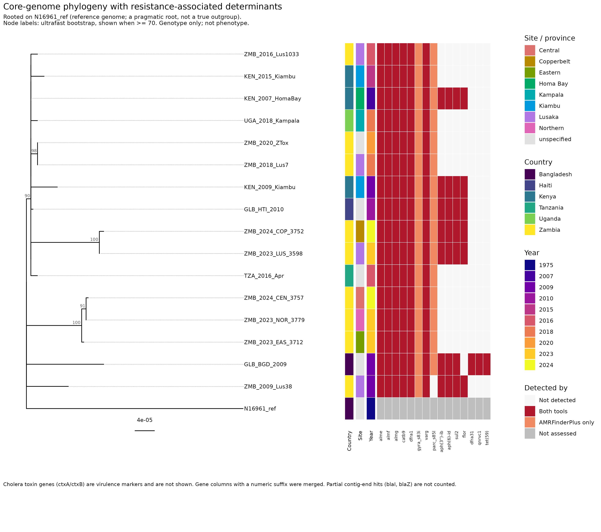

# Cholera genomic surveillance and antimicrobial-resistance analysis

A reproducible bacterial-genomics workflow on public *Vibrio cholerae* data, from accession retrieval through QC, assembly, AMR detection and variant calling to phylogeny and figures.

**Research question:** What genomic differences distinguish selected *V. cholerae* isolates, and what resistance-associated genetic determinants can be identified in their genomes?

> **Scope and caution.** The isolates are a small, convenience set of public genomes and do not represent cholera in Zambia or anywhere else as a whole. Resistance genes and mutations are reported as **resistance-associated determinants (genotype)**. No phenotype data were available, so nothing here proves phenotypic resistance.

## Design
- 16 isolates against the N16961 reference (GCF_000006745.1): 13 analysed from sequencing reads and 3 pre-assembled Lusaka genomes (PRJNA701309). Kenya, Uganda, Tanzania, Haiti, Bangladesh and Zambia (2007-2024).
- One further isolate (TZA_2017_DarEsSalaam) was excluded after assembly QC. Every accession, date and location is in `config/metadata.tsv`.

## Workflow
| Step | Script | Main tools |
|---|---|---|
| Candidate search and metadata | `scripts/00_find_candidates.sh`, `00b_illumina_runs.sh`, `00c_runs_for_biosamples.sh` | ENA / NCBI queries |
| Download | `scripts/01_download_data.sh` | SRA / ENA |
| Read QC | `scripts/02_qc.sh` | FastQC, fastp, MultiQC |
| Assembly and assembly QC | `scripts/03_assembly.sh` | seqtk (100x), SPAdes `--isolate`, QUAST, CheckM2, fastANI, MLST |
| Annotation and AMR | `scripts/04_amr_annotation.sh` | Bakta, AMRFinderPlus, ABRicate (ResFinder, CARD) |
| Variants and phylogeny | `scripts/05_variants_phylogeny.sh` | Snippy, snippy-core, Gubbins, snp-sites, snp-dists, IQ-TREE 2 |
| Figures and tables | `R/06_visualise.R` | R, ggtree, pheatmap |

`scripts/run_all.sh` chains the steps. Each script documents its arguments in its header.

## Main findings (descriptive)



*Core-SNP phylogeny (IQ-TREE 2, recombination masked) with resistance-associated determinants. Genotype only; the tree is rooted on N16961 as a pragmatic root.*

- Isolates aligned to about 96-97% of the reference. After recombination masking the alignment had 247 variable sites (63 parsimony-informative), so tree resolution is limited; only a few clades have strong support.
- A tight older group of East African, Haitian and earlier Zambian isolates differs by few SNPs. The 2023-24 Zambian isolates fall into two distinct groups about 59-63 SNPs apart, each tens of SNPs from the older group.
- Determinants present in every isolate: almEFG, catB9, dfrA1, varG and gyrA S83I. parC S85L is present in all but ZMB_2009_Lus38. A cluster of aph(3'')-Ib, aph(6)-Id, sul2 and floR occurs in a subset of isolates.

See `report/` for the write-up and `results/figures/` for the figures (`fig_tree_amr.png` is the main one).

## Reproducing
```bash
git clone <this repo> && cd <this repo>
bash create_envs.sh                              # creates the conda environments
conda env create -f envs/chol-snippy.yml         # Snippy >= 4.6 lives in its own environment
bash scripts/run_all.sh                          # or run the numbered scripts one by one
```
Environments: `chol-qc`, `chol-asm`, `chol-checkm2`, `chol-amr`, `chol-phylo`, `chol-snippy`, `chol-r` (specifications and lock files in `envs/`). Tool versions used are in `envs/*.lock.yml` and `logs/phylo_tool_versions.txt`.

Raw reads, per-isolate alignments, BAM files and bulky QC output are **not** stored in the repository. They are regenerated from the accessions in `config/metadata.tsv` by the scripts above. Only small, report-ready results are committed.

## Methods notes
- Assembly: reads are subsampled to about 100x (seqtk, seed 100) before SPAdes because Shovill could not run within the laptop's memory.
- AMR: AMRFinderPlus 3.12.8 (database 2024-07-22.1, outdated, a stated limitation) and ABRicate (ResFinder, CARD). Partial contig-end hits are not counted. ctxA/ctxB are virulence markers and are not shown as AMR.
- Phylogeny: Snippy 4.6.0 against N16961, Gubbins 3.4.3 recombination masking, IQ-TREE 2 with `MFP+ASC` and 1000 ultrafast bootstraps. The tree is displayed rooted on N16961, which is a pragmatic root and not a true outgroup.
- Bakta 1.9.4 needed a small local patch (`orf.py`, `cds.py`) to run on this system.
- All decisions, exclusions and fixes are logged in `docs/decisions.md`.

## Limitations
Small non-random sample; low phylogenetic resolution; three genomes entered as assemblies, not reads; one isolate (KEN_2007_HomaBay) has low depth and many heterozygous calls; the AMRFinderPlus database is from July 2024; genotype only.

## Author
Justin Pezulu, 4th-year Bioinformatics student, Copperbelt University (CBU), Zambia.
