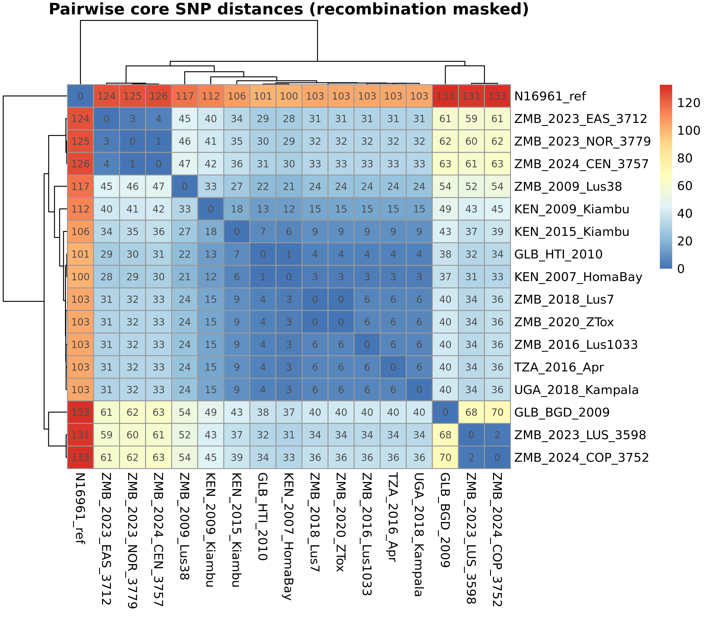
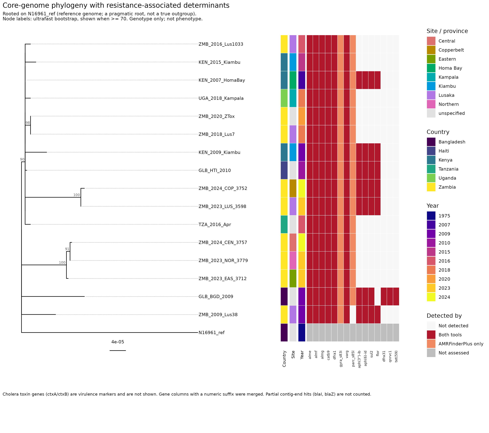
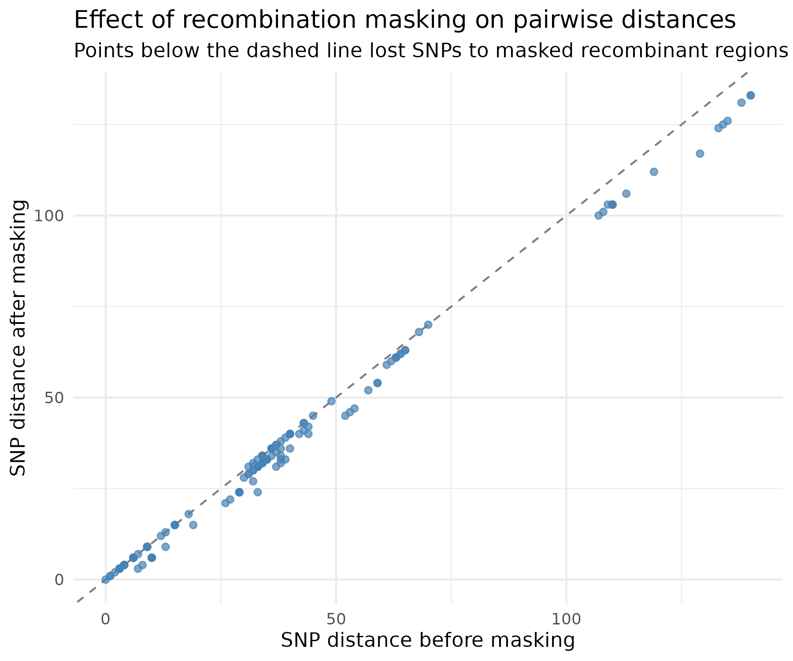
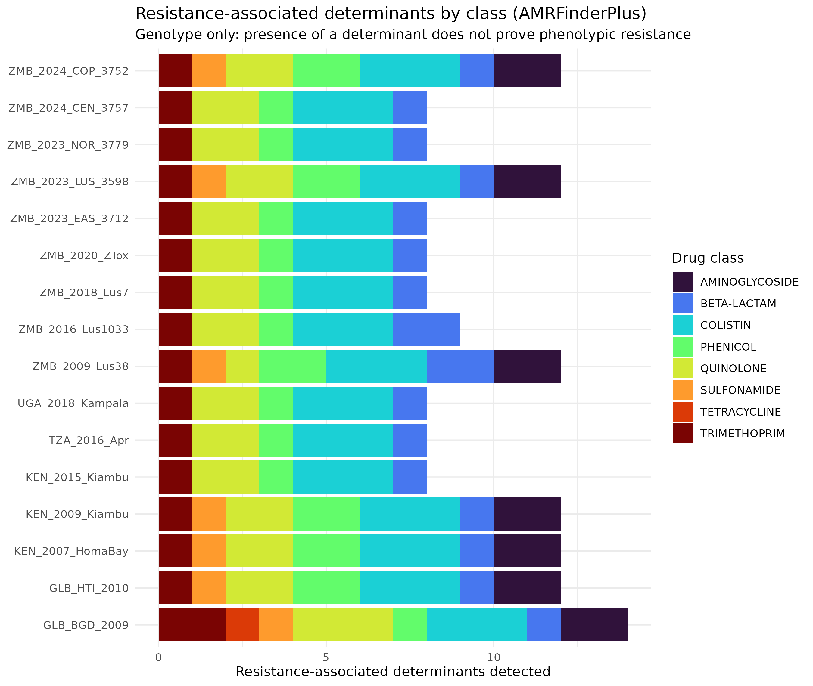

# Abstract {.unnumbered}

**Background.** Genomic surveillance can show how cholera lineages relate to each other and which resistance-associated determinants they carry. **Aim.** To identify genomic differences among a small set of public *Vibrio cholerae* isolates and the resistance-associated genetic determinants in their genomes. **Methods.** Sixteen public genomes (13 analysed from sequencing reads, 3 pre-assembled Lusaka genomes) from Zambia, Kenya, Uganda, Tanzania, Haiti and Bangladesh (2007-2024) were compared with the N16961 reference. Reads were quality-controlled, assembled, and annotated; resistance-associated determinants were called with AMRFinderPlus and ABRicate; variants were called with Snippy, recombination was masked with Gubbins, and a maximum-likelihood tree was inferred with IQ-TREE 2. **Results.** About 96-97% of each genome aligned to the reference. After recombination masking the core alignment held 247 variable sites. Most isolates from 2007-2020 formed a tight group a few SNPs apart, while the Zambian isolates from 2023-24 fell into two distinct groups about 59-63 SNPs apart, each tens of SNPs from the older group; this grouping was unchanged when the three pre-assembled genomes were excluded. Determinants present in every isolate included *almEFG*, *catB9*, *dfrA1*, *varG* and *gyrA* S83I; *parC* S85L was present in all but one isolate; a cluster of *aph(3'')-Ib*, *aph(6)-Id*, *sul2* and *floR* occurred in a subset. **Conclusions.** The 2023-24 Zambian isolates in this set come from at least two distinct lineages. The sample is small and non-random, resolution is limited, and all resistance findings are genotypic: no phenotype data were available.

# Introduction

Cholera is caused by toxigenic *Vibrio cholerae*. The current (seventh) pandemic is driven by the O1 El Tor lineage (7PET), whose global spread has occurred in several waves (Mutreja et al., 2011), and genomic studies have shown repeated introductions of 7PET lineages into Africa (Weill et al., 2017). Genomic data can resolve how isolates from different places and years are related and can reveal acquired resistance determinants, such as those carried on mobile genetic elements.

This project builds a reproducible workflow on public data to ask: *What genomic differences distinguish selected *V. cholerae* isolates, and what resistance-associated genetic determinants can be identified in their genomes?* The aim is a transparent, documented analysis, not a representative survey: the isolates are a small convenience set and do not represent cholera in Zambia or elsewhere as a whole.

# Methods

## Isolates and data

Public isolates were selected from NCBI SRA/ENA to span Zambia, other African countries, and other regions, plus the reference genome N16961 (GCF_000006745.1). Accession numbers, collection dates and locations are recorded in `config/metadata.tsv`. Thirteen isolates were analysed from Illumina reads and three Lusaka genomes (BioProject PRJNA701309) were used as pre-assembled genomes. One further isolate (TZA_2017_DarEsSalaam) was excluded after assembly quality control because its assembly failed four checks: total length 4.47 Mb (above the 4.4 Mb limit), 519 contigs, N50 17.5 kb, and CheckM2 contamination of 14.1%; no MLST sequence type could be assigned. Five other isolates were flagged but retained with caveats (see @sec-qc and the Limitations).

## Read quality control and assembly

Reads were assessed with FastQC and summarised with MultiQC (Ewels et al., 2016); adapters and low-quality bases were removed with fastp (Chen et al., 2018). Because the available laptop could not satisfy Shovill's memory requirements, reads were subsampled to about 100x (seqtk, seed 100, same fraction for both mates) and assembled with SPAdes in `--isolate` mode (Bankevich et al., 2012). Contigs shorter than 200 bp or below 5x coverage were removed. Assemblies were assessed with QUAST (Gurevich et al., 2013), CheckM2 (Chklovski et al., 2023), fastANI and MLST, and flagged against fixed thresholds: genome size 3.8-4.4 Mb, at most 300 contigs, N50 of at least 50 kb, CheckM2 completeness of at least 95%, contamination of at most 5%, and fastANI of at least 95% to N16961.

## Annotation and resistance-associated determinants

Genomes were annotated with Bakta (Schwengers et al., 2021) (light database; version 1.9.4 with a small local patch to run in this environment). Resistance-associated determinants were identified with AMRFinderPlus (Feldgarden et al., 2021) (version 3.12.8, database 2024-07-22.1) and ABRicate (ResFinder (Bortolaia et al., 2020) and CARD (Alcock et al., 2023) databases). Point mutations (for example *gyrA* S83I and *parC* S85L) are reported by AMRFinderPlus only, so they appear as "AMRFinderPlus only" in the figures; this is not disagreement between tools. Partial hits at contig ends (AMRFinderPlus `PARTIAL_CONTIG_END`) were not counted. Cholera toxin genes (*ctxA*, *ctxB*) are virulence markers and are not treated as resistance. Different database entries for the same gene (for example `sul2` and `sul2_2`) were merged. **A determinant is evidence of a genetic basis for resistance, not proof of phenotypic resistance.**

## Variant calling, recombination masking and phylogeny

Reads (or contigs for the three pre-assembled genomes) were mapped to N16961 with Snippy 4.6.0 (Seemann, GitHub). A core SNP alignment was produced with snippy-core, recombination was detected and masked with Gubbins 3.4.3 (Croucher et al., 2015), and invariant-site-corrected maximum-likelihood trees were inferred with IQ-TREE 2 (Minh et al., 2020) using ModelFinder (Kalyaanamoorthy et al., 2017) with ascertainment-bias correction (`MFP+ASC`) and 1,000 ultrafast bootstrap replicates (Hoang et al., 2018). The tree is displayed rooted on the N16961 reference, which is a pragmatic root: N16961 is itself a seventh-pandemic El Tor isolate and not a true outgroup. Pairwise SNP distances were computed with snp-dists, and figures were drawn in R with ggtree (Yu et al., 2017) and pheatmap.

## Sensitivity analysis

To test whether the three pre-assembled genomes influenced the results, the core-alignment, recombination-masking and tree steps were repeated with those three genomes (and TZA_2017_DarEsSalaam) excluded, leaving 13 read-based isolates plus N16961 (`scripts/07_sensitivity.sh`; outputs in `results/sensitivity_no_assemblies/`).

## Reproducibility

All scripts, environment specifications and decisions are in the project repository (`scripts/`, `R/`, `envs/`, `docs/decisions.md`). Raw reads and bulky intermediate files are not stored and are regenerated from the accessions.

# Results

## Dataset and assembly quality {#sec-qc}

All 17 assembled isolates were complete (CheckM2 completeness 99.99-100%) and had 99.97-99.99% ANI to N16961. Eleven passed all thresholds. TZA_2017_DarEsSalaam failed on size, fragmentation, N50 and contamination and was excluded (Methods). Five were flagged but retained: KEN_2007_HomaBay (N50 31.3 kb), ZMB_2009_Lus38 (585 contigs), ZMB_2016_Lus1033 (349 contigs), UGA_2018_Kampala (contamination 7.8%, N50 37.5 kb) and ZMB_2018_Lus7 (contamination 5.2%, 327 contigs). Contamination can add spurious variants or resistance hits, so findings for these isolates carry extra uncertainty; as a partial check, ZMB_2018_Lus7 was identical in core SNPs to ZMB_2020_ZTox, which passed all thresholds.

## Dataset and alignment

After exclusion, 16 isolates were analysed. Each aligned to about 96-97% of the 4,033,464 bp N16961 reference (Table 1). The three pre-assembled genomes aligned slightly less (about 95.6-96.0%), as expected for assemblies with some gaps. KEN_2007_HomaBay had by far the most heterozygous calls (8,808), consistent with its low depth, and should be interpreted with care.

**Table 1.** Alignment of each isolate to N16961 (before recombination masking).

| Isolate | Aligned to N16961 (bp) | Aligned (%) | SNPs vs N16961 (before masking) | Heterozygous calls | Low-coverage sites |
|---|---:|---:|---:|---:|---:|
| GLB_BGD_2009 | 3,916,720 | 97.1 | 182 | 2,506 | 13,005 |
| GLB_HTI_2010 | 3,913,454 | 97.0 | 186 | 1,437 | 10,112 |
| KEN_2007_HomaBay | 3,899,247 | 96.7 | 137 | 8,808 | 17,663 |
| KEN_2009_Kiambu | 3,907,037 | 96.9 | 149 | 1,359 | 10,655 |
| KEN_2015_Kiambu | 3,912,557 | 97.0 | 143 | 127 | 8,022 |
| TZA_2016_Apr | 3,903,305 | 96.8 | 140 | 2,293 | 19,173 |
| UGA_2018_Kampala | 3,910,415 | 96.9 | 140 | 1,082 | 22,776 |
| ZMB_2009_Lus38 | 3,872,972 | 96.0 | 158 | 12 | 28,745 |
| ZMB_2016_Lus1033 | 3,868,359 | 95.9 | 134 | 8 | 23,654 |
| ZMB_2018_Lus7 | 3,856,136 | 95.6 | 134 | 114 | 37,232 |
| ZMB_2020_ZTox | 3,908,933 | 96.9 | 134 | 1,003 | 2,856 |
| ZMB_2023_EAS_3712 | 3,916,704 | 97.1 | 157 | 381 | 4,104 |
| ZMB_2023_LUS_3598 | 3,909,370 | 96.9 | 162 | 466 | 3,250 |
| ZMB_2023_NOR_3779 | 3,917,445 | 97.1 | 158 | 248 | 3,361 |
| ZMB_2024_CEN_3757 | 3,918,474 | 97.1 | 159 | 254 | 2,938 |
| ZMB_2024_COP_3752 | 3,910,113 | 96.9 | 164 | 325 | 2,814 |

After Gubbins masking, the alignment contained 247 variable sites, of which 63 were parsimony-informative. IQ-TREE selected K3P+ASC as the best-fit model.

## Relationships among isolates

Pairwise SNP distances (recombination masked) are shown in @fig-snp. Isolates were 100-133 SNPs from N16961. Three patterns stand out (Table 2):

1. **An older group.** Isolates from Kenya, Haiti, Tanzania, Uganda and the Zambian genomes from 2016, 2018 and 2020 differed by few SNPs (mostly 0-9; up to 18 when KEN_2009_Kiambu is included). ZMB_2018_Lus7 and ZMB_2020_ZTox were identical in the core alignment.
2. **Two groups among the 2023-24 Zambian isolates.** ZMB_2023_EAS_3712, ZMB_2023_NOR_3779 and ZMB_2024_CEN_3757 differed from each other by 1-4 SNPs; ZMB_2023_LUS_3598 and ZMB_2024_COP_3752 differed by 2 SNPs. The two groups were about 59-63 SNPs apart, and each was about 28-43 SNPs from the older group.
3. **Two intermediate or distant isolates.** ZMB_2009_Lus38 lay between the groups (about 21-33 SNPs from the older group), and GLB_BGD_2009 was the most distant isolate (37-70 SNPs from all others).

**Table 2.** Summary of core-SNP distances (recombination masked).

| Comparison | SNP distance |
|---|---|
| Within the older group | mostly 0-9 (up to 18 including KEN_2009_Kiambu) |
| Within EAS_3712 / NOR_3779 / CEN_3757 | 1-4 |
| Within LUS_3598 / COP_3752 | 2 |
| EAS/NOR/CEN vs LUS/COP | about 59-63 |
| EAS/NOR/CEN vs older group | about 28-40 |
| LUS/COP vs older group | about 31-43 |
| ZMB_2009_Lus38 vs older group | about 21-33 |
| GLB_BGD_2009 vs others | about 37-70 |

{#fig-snp}

The maximum-likelihood tree (@fig-tree) agrees with these groupings, but resolution is limited: with only 63 informative sites, most internal nodes have low ultrafast bootstrap support. Only the 2023-24 groups (support 100 for EAS/NOR/CEN with 91 for the NOR/CEN pair, and 100 for LUS/COP) and the ZMB_2018_Lus7 / ZMB_2020_ZTox pair (98) are well supported. Branching order within the older group should not be interpreted.

{#fig-tree}

Gubbins masking reduced pairwise distances (@fig-recomb).

{#fig-recomb}

## Resistance-associated determinants

Determinants detected (genotype only) are summarised in Table 3 and shown beside the tree in @fig-tree.

**Table 3.** Resistance-associated determinants detected.

| Determinant (drug class) | Isolates |
|---|---|
| *almE*, *almF*, *almG* (colistin/polymyxin-associated) | all 16 |
| *catB9* (phenicol) | all 16 |
| *dfrA1* (trimethoprim) | all 16 |
| *varG* (beta-lactam) | all 16 |
| *gyrA* S83I (quinolone) | all 16 |
| *parC* S85L (quinolone) | all except ZMB_2009_Lus38 |
| *aph(3'')-Ib*, *aph(6)-Id* (streptomycin), *sul2* (sulfonamide), *floR* (phenicol) | KEN_2007_HomaBay, KEN_2009_Kiambu, GLB_HTI_2010, ZMB_2023_LUS_3598, ZMB_2024_COP_3752, ZMB_2009_Lus38 |
| *aph(3'')-Ib*, *aph(6)-Id*, *sul2*, plus *dfrA31* (trimethoprim), *qnrVC1* (quinolone), *tet(59)* (tetracycline); no *floR* | GLB_BGD_2009 |

ZMB_2009_Lus38 carries the wild-type base at the *parC* S85 position, confirmed as a real base call in the alignment (not a gap), whereas the later isolates carry S85L. Two additional hits (*blaZ* in ZMB_2016_Lus1033 and *blaI* in ZMB_2009_Lus38) were partial contig-end matches (70% and 79% coverage) on small contigs of public draft assemblies and were not counted.

{#fig-class}

## Sensitivity to the pre-assembled genomes {#sec-sens}

Excluding the three pre-assembled Lusaka genomes left the main conclusions unchanged (Table 4). The core alignment kept the same aligned length for every remaining isolate, and the number of variable sites fell from 247 to 228 (61 parsimony-informative). The 2023-24 isolates gained about 6-8 SNPs against N16961 (for example ZMB_2023_EAS_3712 157 to 165), because a few variant sites had previously been lost where the assemblies had gaps. Distances among the older isolates were unchanged, the two 2023-24 groups stayed about 60-64 SNPs apart, and the ZMB_2023_LUS_3598 / ZMB_2024_COP_3752 clade remained fully supported (SH-aLRT 100, ultrafast bootstrap 100).

**Table 4.** Main analysis versus the analysis without pre-assembled genomes.

| Measure | Main (16 isolates) | Without assemblies (13 isolates) |
|---|---|---|
| Variable sites | 247 | 228 |
| Parsimony-informative sites | 63 | 61 |
| Within EAS / NOR / CEN | 1-4 SNPs | 1-4 SNPs |
| Within LUS / COP | 2 SNPs | 2 SNPs |
| Between the two 2023-24 groups | 59-63 SNPs | 60-64 SNPs |
| EAS / NOR / CEN vs older group | about 28-40 SNPs | about 28-42 SNPs |
| LUS / COP vs older group | about 31-43 SNPs | about 32-46 SNPs |

# Discussion

**Two lineages among the 2023-24 Zambian isolates.** The five 2023-24 Zambian isolates did not form one cluster: they split into two groups about 60 SNPs apart. Each group is internally tight (1-4 SNPs) and each is tens of SNPs from the older isolates. This is consistent with at least two genetically distinct lineages circulating in Zambia in 2023-24. The grouping was unchanged when the three pre-assembled genomes were excluded. It does not show how common either lineage is, because the isolates were chosen, not sampled at random. Published estimates of the 7PET substitution rate are a few SNPs per year, so differences of tens of SNPs imply years of divergence and not a single recent outbreak chain; this reading should be tested with dated analyses and more isolates.

**Resistance determinants and mobile elements.** *almEFG*, *catB9*, *varG* and *dfrA1* appeared in every isolate, and *gyrA* S83I was universal in this set. The combination of *aph(3'')-Ib* (strA), *aph(6)-Id* (strB), *sul2* and *floR* is commonly reported on SXT-type integrative conjugative elements in *V. cholerae*; this study did not confirm the element, and its absence from some isolates could be real or could reflect a fragmented element in an assembly. *parC* S85L was present in all but the 2009 Lusaka isolate, which is consistent with that earlier isolate predating the mutation but is based on one genome. GLB_BGD_2009 carried a different set including *qnrVC1* and *tet(59)*.

**Genotype is not phenotype.** None of these findings establishes resistance. Confirming it would need antimicrobial susceptibility testing of the isolates.

# Limitations

- Small, non-random sample of public genomes; only five Zambian isolates from 2023-24. The results do not represent cholera in Zambia or elsewhere.
- Low phylogenetic resolution (247 variable sites, 63 informative); most internal nodes have weak support.
- N16961 is a pragmatic root and not a true outgroup.
- Three genomes entered as pre-assembled contigs, not reads, so they are not strictly comparable; a sensitivity analysis without them gave the same grouping (@sec-sens).
- KEN_2007_HomaBay had low depth (about 56x after trimming) and many heterozygous calls.
- Five retained isolates were flagged in assembly QC (fragmentation, low N50, or contamination up to 7.8%); contamination can add spurious variants or resistance hits.
- The AMRFinderPlus database (2024-07-22.1) is out of date.
- Genotype only; no phenotypic susceptibility data.

# Conclusions

In this small public dataset, the Zambian isolates from 2023-24 belong to at least two distinct lineages, both clearly separated from earlier East African isolates, and a core set of resistance-associated determinants is shared by all isolates while a mobile-element-like cluster is present in only some. The workflow is documented and reproducible; conclusions about prevalence or resistance phenotype would need larger systematic sampling and phenotypic testing.

# Data and code availability

All data are public (accessions in `config/metadata.tsv`). Code, environments, figures and tables are at <https://github.com/justinpezulu3/cholera-genomic-surveillance-amr>.

# References {.unnumbered}

*Check each reference against the original before submission.*

- Alcock BP et al. (2023). CARD 2023. *Nucleic Acids Research* 51:D690-D699.
- Bankevich A et al. (2012). SPAdes. *Journal of Computational Biology* 19:455-477.
- Bortolaia V et al. (2020). ResFinder 4.0. *Journal of Antimicrobial Chemotherapy* 75:3491-3500.
- Chen S et al. (2018). fastp. *Bioinformatics* 34:i884-i890.
- Chklovski A et al. (2023). CheckM2. *Nature Methods* 20:1203-1212.
- Croucher NJ et al. (2015). Gubbins. *Nucleic Acids Research* 43:e15.
- Ewels P et al. (2016). MultiQC. *Bioinformatics* 32:3047-3048.
- Feldgarden M et al. (2021). AMRFinderPlus. *Scientific Reports* 11:12728.
- Gurevich A et al. (2013). QUAST. *Bioinformatics* 29:1072-1075.
- Hoang DT et al. (2018). UFBoot2. *Molecular Biology and Evolution* 35:518-522.
- Kalyaanamoorthy S et al. (2017). ModelFinder. *Nature Methods* 14:587-589.
- Minh BQ et al. (2020). IQ-TREE 2. *Molecular Biology and Evolution* 37:1530-1534.
- Mutreja A et al. (2011). Several waves of global transmission in the seventh cholera pandemic. *Nature* 477:462-465.
- Schwengers O et al. (2021). Bakta. *Microbial Genomics* 7:000685.
- Seemann T. Snippy and ABRicate. <https://github.com/tseemann>
- Weill F-X et al. (2017). Genomic history of the seventh pandemic of cholera in Africa. *Science* 358:785-789.
- Yu G et al. (2017). ggtree. *Methods in Ecology and Evolution* 8:28-36.
